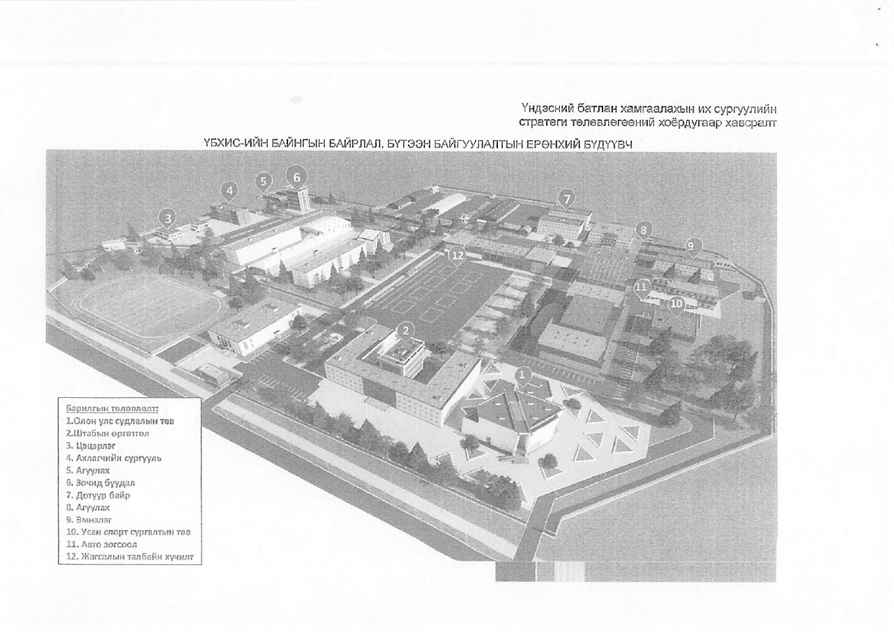

# ҮБХИС-ийн 105 жилийн ой – Стратеги төлөвлөгөөний видео танилцуулгын зохиол

Огноо: 2026-10-13 · Хувилбар 1.0 · Эх сурвалж: Батлан хамгаалахын сайдын 2026.07.07-ны А/307 тушаал (ҮБХИС-ийн хөгжлийн стратеги, 2026-2030 он хүртэл хэрэгжүүлэх стратеги төлөвлөгөө, төсвийн төсөөлөл, ерөнхий бүдүүвч)

Засварлах, сэтгэгдэл бичих хувилбар: https://claude.ai/code/artifact/54b914c3-c49a-42fd-9e96-8dbcdf051f37

## 1. Видеоны ерөнхий үзэл баримтлал

Видео нэг л мессежийг 3 минут 40 секундэд хүргэнэ: **«105 жилийн өв дээр ҮБХИС 2036 он гэхэд үндэсний шилдэг 5 их сургуулийн нэг болно»**.

**Ажлын нэр (сонголт):** «Өв. Өнөөдөр. Ирээдүй — ҮБХИС 2036» · «105 жил, нэг зорилго» · «Ирээдүйг бүтээгч их сургууль»

| Үзүүлэлт | Шийдэл |
| --- | --- |
| Зорилго | Стратеги төлөвлөгөөг зочид, төлөөлөгч, ард иргэдэд ойлгомжтой, сэтгэл хөдөлгөм, сүр жавхлантай хүргэх |
| Үзэгч | Төрийн өндөр албан тушаалтан, гадаадын төлөөлөгч, ахмад дайчид, төгсөгчид, сонсогчид, ард иргэд. Мэргэжлийн нэр томьёо бага, дүрслэл давамгай |
| Хугацаа | 3:40 (3:30–3:50 хооронд хэлбэлзэж болно) |
| Формат | 16:9, 4K UHD, 25 fps, их дэлгэц (LED хана) дээр үзүүлэх; 1080p хувилбарыг сошиал сүлжээнд |
| Хэл | Монгол хөтлөгчийн дуу (эрэгтэй, гүн, тайван), англи хадмал орчуулга |
| Өнгө аяс | Сүр жавхлантай, итгэл төгс, ирээдүй рүү тэмүүлсэн. Өнгөрсөн (хар цагаан, архив) → Өнөөдөр (бодит дрон, сонсогчид) → Ирээдүй (3D дүрслэл, гэрэлтсэн өнгө) |
| Гол дүрслэлийн арга | Агаараас авсан өнөөдрийн байнгын байрлал 3D ерөнхий бүдүүвч рүү «хувирч», 12 шинэ объект ээлжлэн гэрэлтэн босно |
| Хөгжим | Оркестр + цэргийн бөмбөр, 3 үе шаттай өсөлттэй (архив → стратеги → бүтээн байгуулалт), төгсгөлд сүлд дууны аяс |

**Үзэгчийн толгойд үлдэх 3 зүйл:**

1. Алсын хараа: батлан хамгаалахын боловсрол, судалгааг олон улсын жишигт хүргэх.
2. Стратеги 5 зорилт, 3 үе шаттай (2026-2028, 2029-2032, 2033-2036) бодитой хэрэгжинэ.
3. 2030 он хүртэл 96 гаруй тэрбум төгрөгийн барилга, байгууламж, сургалтын орчны хөрөнгө оруулалт: Олон улс судлалын төв, Ахлагчийн политехник коллежийн хичээлийн байр, 500 сонсогчийн дотуур байр, Усан спорт сургалтын төв, Эрүүл мэндийн төв зэрэг 12 шинэ объект.

## 2. Зохиолын санаа ба бүтэц

Зохиол гурван үеийн драматургиар явна: **Өв** (105 жилийн түүх), **Өнөөдөр** (тулгамдсан асуудал ба шийдвэр), **Ирээдүй** (стратеги, бүтээн байгуулалт, үр дүн). Хамгийн сүртэй мөч нь 1:30–2:40 хооронд: агаараас авсан өнөөдрийн байнгын байрлал дээр 3D ерөнхий бүдүүвчийн 12 объект ээлжлэн босож, видеоны бараг гуравны нэгийг эзэлнэ.

| # | Хэсэг | Цаг | Дүрслэл | Мессеж |
| --- | --- | --- | --- | --- |
| 1 | Нээлт: 105 жилийн өв | 0:00–0:30 | Архивын хар цагаан кадр өнгөт болон хувирна, жагсаалын талбай дээр сонсогчдын алхаа, «105» тоо босно | 105 жил эх орноо хамгаалах эрдмийг заасан |
| 2 | Өнөөдөр: асуудал ба шийдвэр | 0:30–0:55 | Дрон кадр, 40 жил давсан барилгууд, 2026.07.07 тушаалын гарын үсэг | Шинэчлэлийг хойшлуулах боломжгүй, стратеги батлагдлаа |
| 3 | Алсын хараа, 5 зорилт | 0:55–1:30 | Мотион график: алсын хараа, эрхэм зорилго, 5 тулгуур багана, бодит кадруудтай холилдоно | Олон улсын жишигт хүрнэ |
| 4 | Бүтээн байгуулалт | 1:30–2:40 | 3D нислэг (fly-through): 12 объект нэр, он, төсөвтэйгээ ээлжлэн босно; Шархад, Шонхор, Тэмүүжин-Өрлөг | 96 гаруй тэрбум төгрөгийн бодит хөрөнгө оруулалт |
| 5 | Сургалтын ахиц, шинэчлэл | 2:40–3:15 | Тоон үзүүлэлтийн анимаци, лаборатори, симулятор, дрон, гадаад солилцоо | Чанар, тоо хоёулаа өснө |
| 6 | Төгсгөл: 2036 | 3:15–3:40 | 3 үе шатны замын зураг, сонсогчдын тангараг, лого, уриа | 2036: Үндэсний шилдэг 5 их сургуулийн нэг |

Зургадугаар хэсэгт дэлгэцэнд гарах замын зураг (Хөгжлийн стратегийн 3 үе шат):

| I үе шат · 2026–2028 | II үе шат · 2029–2032 | III үе шат · 2033–2036 |
| --- | --- | --- |
| **Суурь нөхцөл бүрдүүлэх** | **Бүтээн байгуулалтын үе** | **Үндэсний шилдэг 5-д жагсана** |
| Олон улсын жишигт нийцсэн сургалт, судалгааны суурь | Цэргийн инженерийн сургууль | Сургалт, судалгаа тогтворжино |
| Эрүүл мэндийн төв (2026) | АПК хичээлийн байр (2030) | Эрэмбэ, элсэлтээр эхний 5-д |
| Олон улс судлалын төв (2027) | Усан спортын төв (2030) | h-индекстэй багш 30-аас дээш |
| 2 дотуур байр, 500 ор (2027) | Нэгдсэн агуулах (2030) | Хиймэл оюун, автоматжуулалт чиглэлийн мэргэжилтэн |
| Ухаалаг их сургууль (2028) | ЭШ дундаж оноо 650 (2030) | Гарааны компани, инновац |
| ЦХПК коллежийн статус (2028) | Докторын зэрэгтэй багш 40% | Олон улсын жишигт хүрнэ |
| | Гадаадад суралцагч 60 (2030) | |

Эхний үе шат суурийг тавьж, хоёрдугаар үе шатанд томоохон барилгууд ашиглалтад орж, гуравдугаар үе шатанд үр дүн тогтворжино. Видеонд энэ зургийг зүүнээс баруун тийш ээлжлэн гэрэлтүүлж үзүүлнэ.

## 3. Бүрэн зохиол: хэсэг тус бүрийн текст, дүрслэл, AI prompt

Хөтлөгчийн текст нийт 375 орчим үг, 3:40 минутад удаан, сүр жавхлантай уншина (минутад 100 орчим үг). Хэсэг бүрд дүрслэл (монголоор), AI дүрс үүсгэх prompt (англиар, image-to-video хэрэгслүүд англи prompt-д илүү сайн ажилладаг), хөтлөгчийн текст, дэлгэцний бичвэр, дуу хөгжим багтана. Тоо баримт бүгд А/307 тушаалын хавсралтаас авсан.

### Хэсэг 1 · 0:00–0:30 · Нээлт: 105 жилийн өв

**Дүрслэл.** Хар дэлгэц, бөмбөрийн нэг цохилт. 1921 оны архивын хар цагаан зураг: анхны цэргийн сургуулийн сонсогчид. Кадрууд хурдасч ээлжилнэ: 1940, 1970, 1990, 2000-аад оны төгсөлт, жагсаал, сургуулилт. Хар цагаан аажим өнгөт болж, өнөөдрийн жагсаалын талбай дээр сонсогчдын алхаа руу шилжинэ. Дрон дээш өргөгдөж, «105» гэсэн тоо алтан өнгөөр дэлгэцэнд босно.

**AI дүрслэл.** Архивын бодит зургийг AI-аар сэргээж (Topaz, Magnific зэргээр upscale, colorize), хөдөлгөөнтэй болгоно (Runway, Kling image-to-video). Prompt:

```
Restored 1920s black-and-white archival photograph of Mongolian military cadets standing in formation, subtle parallax camera push-in, film grain, slow dissolve into vivid color; then aerial drone shot rising over a parade ground where cadets in modern uniform march in formation at golden hour, cinematic, respectful, 4K, slow motion
```

**Хөтлөгчийн текст.**

> Нэг зуун таван жил. Эх орноо хамгаалах эрдмийг үеэс үед өвлүүлсэн жилүүд. 1921 оноос өнөөдрийг хүртэл Үндэсний батлан хамгаалахын их сургууль Монгол цэргийн оюун, зүрх, сахилга батыг төлөвшүүлсээр ирлээ. Өнөөдөр бид түүхээ хүндэтгэн, ирээдүйгээ зарлаж байна.

**Дэлгэцний бичвэр.** «105 ЖИЛ» · «1921–2026» · «Үндэсний батлан хамгаалахын их сургууль»

**Дуу, хөгжим.** Бөмбөрийн ганц цохилт, дараа нь морин хуурын намуухан аялгуу, чавхдаст хөгжим аажим өснө.

### Хэсэг 2 · 0:30–0:55 · Өнөөдөр: асуудал ба шийдвэр

**Дүрслэл.** Дрон өнөөдрийн байнгын байрлал дээгүүр нисч, хуучирсан хичээлийн байр, дотуур байр, штабын фасадыг бодитоор үзүүлнэ. Дэлгэцэнд тоо гарна: «60 объектын 36 нь 40-өөс дээш жилийн настай». Дараа нь ойрын кадр: тушаалын хуудас, гарын үсэг зурагдаж, улаан тамга дарагдана. «2026.07.07 · А/307» гэсэн бичвэр.

**AI дүрслэл.** Бодит дрон кадр байвал түүнийг ашиглаж, AI-аар зөвхөн тогтворжуулж, өнгө засна. Гарын үсгийн кадрыг AI-аар үүсгэнэ:

```
Macro cinematic shot of a fountain pen signing an official government document on a dark wooden desk, red seal stamp pressed firmly, shallow depth of field, warm desk lamp light, slow motion, 4K
```

Хуучин барилгын кадр AI-аар хэрэгтэй бол:

```
Aerial drone footage slowly pushing over an aging university campus with weathered concrete buildings from the 1980s, autumn light, long shadows, documentary realism, no people
```

**Хөтлөгчийн текст.**

> Гэвч цаг хугацаа ул мөрөө үлдээжээ. Их сургуулийн жаран барилгын гучин зургаа нь дөчөөс дээш жилийн настай. Сургалтын орчин өнөөгийн шаардлагаас хоцорч байна. Тиймээс 2026 оны долдугаар сарын долооны өдөр Батлан хамгаалахын сайдын тушаалаар Хөгжлийн стратеги, 2030 он хүртэлх стратеги төлөвлөгөө батлагдлаа. Шинэчлэл эхэллээ.

**Дэлгэцний бичвэр.** «60 объект · 36 нь 40+ жилийн настай» · «2026.07.07 · Батлан хамгаалахын сайдын А/307 тушаал» · «ШИНЭЧЛЭЛ ЭХЭЛЛЭЭ»

**Дуу, хөгжим.** Хөгжим намсаж, салхи, дроны намуухан чимээ. Гарын үсэг, тамганы дуу тод. «Шинэчлэл эхэллээ» дээр бөмбөр хүчтэй орно.

### Хэсэг 3 · 0:55–1:30 · Алсын хараа, эрхэм зорилго, 5 зорилт

**Дүрслэл.** Хар хөх, алтан өнгийн мотион график. Алсын хараа текст болон босно, дараа нь эрхэм зорилго. Таван тулгуур багана ээлжлэн гэрэлтэж, тус бүрийн ард бодит кадр нээгдэнэ: (1) ангид хичээллэж буй офицер, ахлагч нар; (2) номын санд судлаач, докторын хамгаалалт; (3) инженерийн лаборатори, дрон угсарч буй сонсогч; (4) Тэмүүжин-Өрлөг сургуулийн сурагчид, Шонхор зуслангийн хүүхдүүд; (5) хээрийн сургуулилт, буудлага. Доор нь үнэт зүйлс: Эх орон · Мэдлэг, боловсрол · Нэр төр · Сахилга бат · Манлайлал.

**AI дүрслэл.** Мотион графикийг After Effects эсвэл AI motion хэрэгслээр (Runway, Pika) хийнэ. Бодит хүмүүсийн кадрыг аль болох жинхэнэ зураг авалтаар авна; AI-аар зөвхөн ар фон, шилжилтийг бүтээнэ:

```
Elegant motion graphics: five tall glowing pillars rising one by one from a dark navy background with gold light accents, each pillar opening a window of live footage; subtle particles, premium institutional style, 4K, seamless loop background
```

**Хөтлөгчийн текст.**

> Алсын хараа: батлан хамгаалахын боловсрол, эрдэм шинжилгээ, судалгааг олон улсын жишигт хүргэх. Эрхэм зорилго: эх оронч, эрдэм мэдлэгтэй, бүтээлч, ёс зүйтэй, өрсөлдөх чадвартай төгсөгчдөөрөө дэлхийд үнэлэгдэх их сургууль болох. Үүний төлөө таван стратегийн зорилт. Нэг: Зэвсэгт хүчний ирээдүй болсон өндөр мэдлэгтэй офицер, ахлагчийг бэлтгэх. Хоёр: аюулгүй байдал, цэргийн ухааны ахисан түвшний сургалт, судалгаа. Гурав: инженер, технологийн инновац бүтээж, батлан хамгаалах үйлдвэрлэлийг дэмжих. Дөрөв: хүүхэд, залуучуудад цэрэг-эх оронч үзлийг төлөвшүүлэх. Тав: үүрэг гүйцэтгэх бэлэн байдал, сургалтын орчныг сайжруулах.

**Дэлгэцний бичвэр.** «АЛСЫН ХАРАА: Олон улсын жишигт» · «5 СТРАТЕГИЙН ЗОРИЛТ» · баганын нэрс: «Офицер, ахлагч» · «Сургалт, судалгаа» · «Инновац, технологи» · «Цэрэг-эх оронч үзэл» · «Бэлэн байдал, орчин» · «Эх орон · Мэдлэг · Нэр төр · Сахилга бат · Манлайлал»

**Дуу, хөгжим.** Оркестр тогтвортой, итгэлтэй хэмнэлтэй. Багана бүр гэрэлтэхэд богино гялалзах (whoosh) эффект.

### Хэсэг 4 · 1:30–2:40 · Бүтээн байгуулалт (гол хэсэг)

**Дүрслэл.** Дрон өнөөдрийн байнгын байрлалаас дээш хөөрнө. Дэлгэц дээр цагаан шугаман ерөнхий бүдүүвч (wireframe) давхарлан гарч, бодит 3D загвар руу хувирна. Камер объект бүр дээр нисч ирэхэд барилга газраас босож (build-up анимаци), баруун доод буланд нэр, он, төсөв гарна. Төгсгөлд бүхэл кампус шөнийн гэрэлтэй гарна. Объектын дугаар нь стратеги төлөвлөгөөний хоёрдугаар хавсралт болох ерөнхий бүдүүвчийн дугаар (4-р хэсэгт зураг бий).

| Цаг | Объект (бүдүүвчийн №) | Он | Төсөв, тэрбум ₮ | Камерын хөдөлгөөн |
| --- | --- | --- | --- | --- |
| 1:30–1:42 | Олон улс судлалын төв (№1) | 2026–2027 | 20.1 | Урдаас дээш өргөгдөх, шилэн фасад наранд гялалзана |
| 1:42–1:52 | Ахлагчийн политехник коллежийн хичээлийн байр (№4) | 2027–2030 | 24.7 | Хажуугаар тойрон нисэх (orbit) |
| 1:52–2:00 | 250 сонсогчийн 2 дотуур байр (№7) | 2027 | 12.0 | Урагш нисэх, цонхнууд ээлжлэн гэрэлтэнэ |
| 2:00–2:08 | Усан спорт сургалтын төв (№10) | 2027–2030 | 15.7 | Дээвэр ил болж бассейн харагдана |
| 2:08–2:16 | Эрүүл мэндийн төв (№9) 2.8 · Нэгдсэн агуулах (№5, №8) 6.7 · Штабын өргөтгөл, фасад (№2) 1.3 · Зочид буудал (№6) · Цэцэрлэг (№3) · Жагсаалын талбай (№12) 0.5 · Авто зогсоол, дотоод зам (№11) 0.6 | 2026–2030 | 11.9 | Хурдан дараалсан босолт, объект бүр 1–2 сек |
| 2:16–2:28 | Шархад хээрийн сургалтын төв: ил театр, халуун усны байр, задгай бассейн, хөлбөмбөгийн талбай, инженер-сапёр, авто жолоодлого, дроны туршилт, практик буудлагын талбай («Цогцолбор хотхон») | 2027–2030 | 2.6 | Агаараас хээрийн төв рүү бууж, объектууд ээлжлэн босно |
| 2:28–2:40 | Шонхор зуслан дөрвөн улирал 1.0 · Тэмүүжин-Өрлөг сургууль: математик-МТ танхим, дроны танхим, спорт заал 0.75 · Барилга-инженер, Авто-механик, Холбоо-радиоэлектроникийн лаборатори 4.2 | 2026–2029 | 6.0 | Дээш хөөрч бүхэл кампус шөнийн гэрэлтэй, «96 тэрбум» бичвэр |

Төсөв нь стратеги төлөвлөгөөний нэгдүгээр хавсралтаас (улсын төсөв 80.1, Зэвсэгт хүчний хөгжлийн сан 9.0, дотоод орлого, төр, нийгмийн түншлэл 6.9, нийт 96.1 тэрбум ₮). Зочид буудал, цэцэрлэг бүдүүвчид байгаа ч төсөвт тусгагдаагүй тул дэлгэцэнд тоо гаргахгүй.

**AI дүрслэл.** Гол дүрэм: Стратеги хавтсанд байгаа албан ёсны зураг төсөл, 3D рендерийг **лавлах зураг (reference image)** болгон image-to-video горимоор хөдөлгөөнтэй болгоно (Kling 2.x, Runway Gen-4, Google Veo 3, Luma). Ингэснээр AI батлагдсан зураг төслөөс өөр барилга зохиохгүй. Зураг төсөл байхгүй объектыг эхлээд Midjourney, Flux эсвэл Nano Banana-гаар ерөнхий бүдүүвчийн хэв маягаар зурж, архитектороор батлуулсны дараа хөдөлгөөнтэй болгоно. Клип бүр 5–10 секунд, нэг ижил гэрэл, улирал (намрын алтан нар) баримтална.

Барилга тойрон нисэх (объект бүрд нэрийг нь солино):

```
Photorealistic architectural visualization, cinematic aerial orbit around a modern [International Studies Center] building with glass and stone facade, golden autumn light, Mongolian flag and university flag on poles, cadets walking on the plaza, camera slowly rising, consistent with the reference render, 4K, 8 seconds
```

Барилга газраас босох (build-up):

```
Time-lapse of a modern university building rising from its foundation on an existing campus, floors assembling upward, scaffolding and cranes fading away, ending as a finished photorealistic building at sunset, smooth camera push-in, 6 seconds
```

Шархад хээрийн сургалтын төв:

```
Aerial drone shot descending over a military field training center in Mongolian steppe hills: open-air amphitheater, outdoor swimming pool, football pitch, drone test field, shooting range, obstacle course, summer, photorealistic, warm light
```

Шөнийн кампус (төгсгөлийн кадр):

```
Aerial night view of a fully renovated modern military university campus, glowing windows, illuminated parade ground, new international center and dormitories, Ulaanbaatar mountains in the background, slow drone pull-back revealing the whole campus, photorealistic, 4K
```

**Хөтлөгчийн текст.**

> Стратеги бол зөвхөн үг биш. Энэ бол бодит бүтээн байгуулалт. 2030 он хүртэл ерэн зургаан тэрбум гаруй төгрөгийн хөрөнгө оруулалтаар их сургуулийн байнгын байрлал бүхэлдээ шинэчлэгдэнэ. Олон улс судлалын төв — их сургуулийн шинэ нүүр царай, 2027 онд. Ахлагчийн политехник коллежийн орчин үеийн хичээлийн байр. Таван зуун сонсогчийн шинэ дотуур байр. Усан спорт сургалтын төв. Эрүүл мэндийн төв — энэ онд. Нэгдсэн агуулах, зочид буудал, цэцэрлэг, шинэ жагсаалын талбай. Шархад хээрийн сургалтын төвд ил театр, бассейн, дроны туршилтын төв, буудлагын талбай бүхий Цогцолбор хотхон байгуулагдана. Шонхор зуслан дөрвөн улирлын турш ажиллана. Тэмүүжин-Өрлөг сургууль, инженерийн лабораториуд шинэ тоног төхөөрөмжөөр тоноглогдоно. Хуучин хана шинэ үеийн өргөө болон хувирна.

**Дэлгэцний бичвэр.** Объект бүр дээр доод гуравны нэгт: «[Нэр] · [Он] · [Төсөв] тэрбум ₮». Төгсгөлд: «2030 ОН: 96 ТЭРБУМ ТӨГРӨГИЙН БҮТЭЭН БАЙГУУЛАЛТ». Бүх AI дүрслэлийн буланд жижиг бичвэр: «Төлөвлөлтийн дүрслэл».

**Дуу, хөгжим.** Хөгжмийн хамгийн хүчтэй хэсэг: бүтэн оркестр, цэргийн бөмбөр, морин хуурын аялгуу. Барилга босох бүрд гүн басс цохилт, шил, төмөр угсрах богино эффект.

### Хэсэг 5 · 2:40–3:15 · Сургалтын ахиц, шинэчлэл

**Дүрслэл.** Тоон үзүүлэлтүүд тоолуур анимациар 2025 оны түвшнээс 2030 оны зорилт руу өснө, ард нь бодит кадр: ангид сонсогчид, нислэгийн симулятор, дрон нисгэж буй сонсогч, гадаад сонсогчид, докторын хамгаалалт, «Цац» сэтгүүл, «Ухаалаг их сургууль» системийн дэлгэц.

| Үзүүлэлт | 2025 | 2030 |
| --- | --- | --- |
| Элсэгчдийн ЭШ-ын дундаж оноо | 545 | 650 |
| Цэргийн мэргэжлийн бакалаврын хөтөлбөр | 19 | 28 |
| Гадаадын цэргийн сургуульд суралцах сонсогч | 24 | 60 |
| Гадаад солилцооны сонсогч | 27 | 70 |
| Докторын зэрэгтэй багш, % | 24.8 | 40 |
| h-индекстэй үндсэн багш, % | 14 | 30 |
| Нэг сонсогчид ногдох сургалтын зардал, стандартын % | 43.4 | 100 |

**AI дүрслэл.** Тоолуурыг After Effects-ээр; ар кадрыг бодит зураг авалт эсвэл AI:

```
Modern military academy classroom, cadets in uniform using tablets and a large interactive display with 3D terrain, flight simulator cockpit with wraparound screens, engineering lab where students assemble a quadcopter drone, clean bright lighting, photorealistic, 4K, no text on screens
```

**Хөтлөгчийн текст.**

> Барилга шинэчлэгдэхийн зэрэгцээ сургалтын чанар өснө. Элсэгчдийн дундаж оноо зургаан зуун тавь. Цэргийн мэргэжлийн хөтөлбөр арван есөөс хорин найм болно. Гадаадад суралцах сонсогч хоёр дахин нэмэгдэнэ. Багш нарын дөчин хувь нь докторын зэрэгтэй болно. Цэргийн инженерийн сургууль, Технологи дамжуулах төв, зэвсэглэл, инновацын судалгааны төв байгуулагдана. Ухаалаг их сургуулийн систем, хиймэл оюун ухаан, нисгэгчгүй төхөөрөмжийн сургалт анги бүрт нэвтэрнэ. Монгол офицер дэлхийн түвшинд суралцана.

**Дэлгэцний бичвэр.** Тоолуурууд: «545 → 650» · «19 → 28 хөтөлбөр» · «24 → 60 гадаадад» · «24.8% → 40% доктор» · «Цэргийн инженерийн сургууль · 2029» · «Ухаалаг их сургууль · 2028»

**Дуу, хөгжим.** Хэмнэл хурдасна, цахим өнгө нэмэгдэнэ (оркестр + синт). Тоолуур бүрд богино тик эффект.

### Хэсэг 6 · 3:15–3:40 · Төгсгөл: 2036

**Дүрслэл.** 2-р хэсэгт байгаа замын зураг зүүнээс баруун тийш гэрэлтэнэ: 2026–2028 · 2029–2032 · 2033–2036. Дараа нь нар мандах үед сонсогчдын тангараг өргөж буй бодит кадр (удаан хөдөлгөөн), шинэ кампусын 3D дүрслэл дээр ҮБХИС-ийн лого, 105 жилийн ойн лого, уриа. Хар дэлгэц.

**AI дүрслэл.** Тангаргийн кадрыг заавал бодит сонсогчдоор авна (бодит хүмүүсийн нүүр царайг AI-аар зохиохгүй). Замын зураг, логоны анимацийг After Effects-ээр; нар мандах ар фоныг AI-аар:

```
Sunrise over a modern military university campus, warm golden light breaking over mountains, lens flare, slow drone rise, hopeful and solemn mood, photorealistic, 4K, 10 seconds
```

**Хөтлөгчийн текст.**

> Гурван үе шат, нэг зорилго. 2028 он — суурь тавигдана. 2032 он — Цэргийн инженерийн сургууль, шинэ кампус бүрэн ашиглалтад орно. 2036 он — Үндэсний батлан хамгаалахын их сургууль Монгол Улсын шилдэг таван их сургуулийн нэг болно. Эх орон. Мэдлэг. Нэр төр. Сахилга бат. Манлайлал. Зуун таван жилийн өв ирээдүйг бүтээнэ.

**Дэлгэцний бичвэр.** «2028 · Суурь» · «2032 · Цэргийн инженерийн сургууль» · «2036 · Үндэсний шилдэг 5» · «ҮБХИС · 105 ЖИЛ» · уриа: «Өв. Өнөөдөр. Ирээдүй.»

**Дуу, хөгжим.** Оркестрын оргил, тангаргийн үед хөгжим тасрахад сонсогчдын дуу хоолой сонсогдоно, дараа нь сүүлийн бөмбөрийн цохилт, чимээгүй байдал 2 секунд.

## 4. Ашиглах материал ба AI продакшны зөвлөмж

Cloud session-оос компьютерийн C:\Users\bilig\Desktop\Стратеги хавтсанд хандах боломжгүй байсан тул зохиолыг зөвхөн хавсаргасан PDF дээр үндэслэн бичсэн. Доорх хүснэгтээр хавтасны материалыг хэсэг бүрт холбоно.

| Хэсэг | Стратеги хавтаснаас авах материал | Байхгүй бол |
| --- | --- | --- |
| 1. Нээлт | Архивын хар цагаан зураг, хуучин кино хальс, музейн зураг, төгсөлтийн зургууд | Их сургуулийн музей, Батлан хамгаалахын яамны архив |
| 2. Өнөөдөр | Одоогийн байрлалын дрон кадр, тушаалын PDF-ийн 1-р хуудас | Дроноор шинээр авах (1 өдөр, намрын нартай өдөр) |
| 3. Стратеги | Лого, брэндбүүк, стратегийн товчоон (PDF-ийн 12-р хуудас), анги, номын сан, лабораторийн зураг | Шинээр зураг авалт (1 өдөр) |
| 4. Бүтээн байгуулалт | Ерөнхий бүдүүвч (доорх зураг), объект тус бүрийн 3D рендер, эскиз зураг төсөл, Шархад, Шонхор, Тэмүүжин-Өрлөгийн фото | AI-аар бүдүүвчийн хэв маягаар үүсгэж, архитектороор батлуулах |
| 5. Сургалт | Сонсогчид, симулятор, дрон, гадаад солилцоо, «Цац» сэтгүүлийн зураг | Шинээр зураг авалт |
| 6. Төгсгөл | Тангаргийн ёслолын видео, 105 жилийн ойн лого, уриа | Ойн логог дизайнераар хийлгэх |



Бүдүүвчийн дугаар: 1 Олон улс судлалын төв · 2 Штабын өргөтгөл · 3 Цэцэрлэг · 4 Ахлагчийн сургууль · 5 Агуулах · 6 Зочид буудал · 7 Дотуур байр · 8 Агуулах · 9 Эмнэлэг · 10 Усан спорт сургалтын төв · 11 Авто зогсоол · 12 Жагсаалын талбайн хучилт. Энэ зургийг 4-р хэсгийн бүх AI дүрслэлийн лавлах зураг болгоно.

**AI продакшны дамжлага**

1. **Зураг (still).** Midjourney, Flux эсвэл Nano Banana: ерөнхий бүдүүвч, байгаа рендерийг хэв маягийн лавлах (style reference) болгоно; 16:9, дараа нь Topaz эсвэл Magnific-аар 4K болгоно. Объект бүрийн зургийг архитектор эсвэл ХӨАА хэлтэс баталсны дараа л видео болгоно.
2. **Видео.** Kling 2.x, Runway Gen-4, Google Veo 3, Luma: image-to-video горим, 5–10 секундын клип, камерын хөдөлгөөнийг prompt-д заана (orbit, push-in, crane up, pull-back). Нэг улирал, нэг гэрэл, нэг өнгөний хэв маяг баримталж, seed-ийг хадгална. Нэг объектд 3–4 хувилбар үүсгэж шилдгийг сонгоно.
3. **Барилга босох анимаци.** 3D загвар (SketchUp, Revit, 3ds Max) байвал Lumion, Twinmotion эсвэл D5 Render-ээр бодит нислэг рендерлэх нь AI-аас илүү үнэн зөв; байхгүй бол 4-р хэсгийн build-up prompt.
4. **Хөтлөгчийн дуу (монгол).** Хамгийн найдвартай нь мэргэжлийн хөтлөгч. AI сонголт: Chimege TTS (монгол хэлний), Microsoft Azure Neural TTS-ийн mn-MN дуу хоолой (Bataa, Yesui), ElevenLabs-ийн сүүлийн загварыг монголоор турших. Тохиргоо: эрэгтэй, гүн, тайван, минутад 100 үг, өгүүлбэр хооронд 0.6 секундын зай. Зохиолд тоог зориуд үгээр бичсэн («ерэн зургаан тэрбум») — TTS зөв уншихын тулд. AI дууг заавал хүн сонсож өргөлт, нэр томьёог шалгана.
5. **Хөгжим.** Suno эсвэл Udio-гоор үүсгэх (доорх prompt), эсвэл Artlist, Epidemic Sound-ын оркестр дээр морин хуурын бодит бичлэг давхарлах. Хөгжмийг зохиолын 6 хэсгийн цагт тааруулж зүснэ.
6. **Хадмал.** Англи орчуулгыг AI-аар хийгээд хүнээр хянана; цэргийн нэр томьёог Гадаад харилцааны албаар батлуулна.
7. **Монтаж.** DaVinci Resolve эсвэл Premiere; өнгө: хар хөх + алт; үсэг: кирилл дэмжсэн нэг фонт (Montserrat эсвэл Roboto); AI дүрслэл бүрийн буланд «Төлөвлөлтийн дүрслэл» гэсэн тэмдэглэгээ.
8. **Баталгаажуулалт.** Бүх тоо, оныг А/307 тушаалтай тулгаж, Стратегийн бодлого, төлөвлөлтийн газар, их сургуулийн удирдлагаар батлуулна. Бодит хүмүүсийн нүүр царайг AI-аар үүсгэхгүй, сонсогчдыг зөвхөн бодит кадраар үзүүлнэ.

Хөгжмийн prompt (Suno, Udio):

```
Cinematic orchestral anthem, military snare drums, brass fanfare, morin khuur (Mongolian horse-head fiddle) melody, slow solemn intro, building to a triumphant climax, instrumental, no vocals, 3 minutes 40 seconds
```

**Продакшны хуваарь (10 ажлын өдөр)**

- [ ] 1–2 өдөр: зохиол, хөтлөгчийн текстийг батлуулах; Стратеги хавтсны материалыг хэсэг бүрээр ялгах
- [ ] 3–5 өдөр: дрон, зураг авалт; AI зураг, видео үүсгэх, архитектороор батлуулах
- [ ] 6–7 өдөр: хөтлөгчийн дуу, хөгжим, дууны эффект
- [ ] 8–9 өдөр: монтаж, өнгө засвар, тоолуур, хадмал
- [ ] 10 өдөр: эцсийн баталгаажуулалт, 4K экспорт, арга хэмжээний LED дэлгэц дээр турших

**Эх сурвалж.** Батлан хамгаалахын сайдын 2026.07.07-ны А/307 тушаал: «ҮБХИС-ийн хөгжлийн стратеги» (1-р хавсралт), «2026-2030 он хүртэл хэрэгжүүлэх стратеги төлөвлөгөө» (2-р хавсралт), төсвийн төсөөлөл, ерөнхий бүдүүвч, 25 хуудас.
